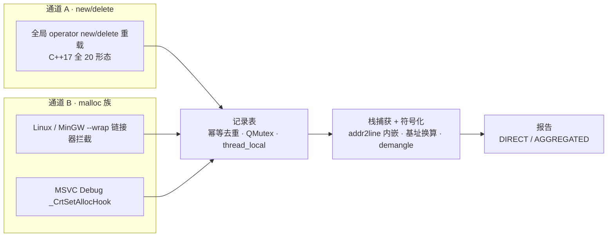

# memleak — Qt C++ 跨平台内存泄漏检测工具


通过 `include(memleak.pri)` 直接引入、**零额外配置**的 new/delete 与 malloc/free/calloc/realloc
双通道内存泄漏检测器。报告期自动解析**真实函数名 + 行号**（addr2line 内嵌，无需外部脚本）。

面向对象设计：`MemLeakDetector` 单例门面 + 配置 / 栈回溯 / 记录表 / 报告策略 4 个模块对象。

## 特性

| 能力 | 说明 |
|------|------|
| 三平台 | Windows MSVC / MinGW / Linux，pri 自动判定注入平台宏 |
| 双通道拦截 | operator new/delete（按标准自适应，C++17 全 20 形态）+ malloc/free/calloc/realloc |
| 标准自适应 | 自动识别 C++ 标准：C++17 全套含 aligned new/delete、C++14 含 sized delete、C++11 基础 8 形态 |
| 多线程安全 | `thread_local` 重入标志防递归 + `QMutex` 保护记录表 + `QAtomicInt` 全局开关 |
| 退出自动打印 | `std::atexit` 注册，进程退出自动输出报告；已显式 dump 则可关闭（`MEMLEAK_AUTO_DUMP_ON_EXIT` ） |
| 输出目标可切换 | 控制台 / 文件（独立开关，可组合、可纯文件） |
| 报告模式可切换 | DIRECT 逐条 / AGGREGATED 按调用栈聚合（定义即优先） |
| 栈帧数可配置 | qmake 变量 `MEMLEAK_STACK_FRAMES`（默认 16） |
| pri 即用 | `include(memleak.pri)` 自动注入宏、`-rdynamic`、`--wrap=...`、`-ldl` / `-ldbghelp` |
| 真实符号 | addr2line 内嵌批量解析，demangle 后函数名 + `file:line`，路径可配 |

## 工作原理



- **通道 A**：重载全部 operator new/delete 形态（按编译标准自适应：
  C++17 全 20 形态含 aligned new、C++14 含 sized delete、C++11 基础 8 形态），
  全平台、Debug/Release 均生效；
- **通道 B**：Linux/MinGW 用 `-Wl,--wrap=` 拦截 malloc/free/calloc/realloc（`__real_*` 转发真实分配器）；
  MSVC Debug 用 `_CrtSetAllocHook` CRT 钩子；
- 双通道**幂等去重**：`new → malloc → CRT 钩子` 在 MSVC 下只记录一次。

## 快速开始

```bash
# Linux
cd example
qmake && make
./memleak_example

# Windows MinGW
cd example
qmake && mingw32-make
memleak_example.exe

# Windows MSVC（VS 开发者命令行）
cd example
qmake && nmake
memleak_example.exe
```

示例输出（Windows MinGW 32 位真机，debug 构建，示意）：

```
==================== memleak report ====================
mode      : DIRECT
leaked    : 15 block(s), 3584 byte(s)
dropped   : 0 (rejected at MAX_RECORDS cap)

  #0  [New]  size=512  align=0  seq=345  t=1ms  thread=1315167821  ptr=0x0052a6c0
          #0  leakViaNew(int) [main.cpp:38] (memleak_example.exe)  +0x407df0
          #1  leakViaNew(int) [main.cpp:36] (memleak_example.exe)  +0x407dd0
          #2  worker(int) [main.cpp:100] (memleak_example.exe)  +0x407e3c
```

## 集成到自己的工程

`.pro` 中（路径按实际情况调整）：

```qmake
include(../memleak.pri)
```

`main.cpp` 中（也可不调用——`MEMLEAK_AUTO_DUMP_ON_EXIT` 默认在退出时自动输出）：

```cpp
#include "memleak.h"

int main() {
    // ... 你的业务代码 ...
    memleak::MemLeakDetector::instance().dumpReport();  // 显式输出（可选）
    return 0;   // 退出时若未显式输出过，自动打印一份
}
```

## 宏与配置

| 宏 / qmake 变量 | 默认 | 作用 |
|---|---|---|
| `MEMLEAK_ENABLED` | 开 | 总开关；include 之后 `DEFINES -= MEMLEAK_ENABLED` 即整体关闭（编译为空实现，零开销） |
| `MEMLEAK_AUTO_DUMP_ON_EXIT` | 开 | 进程退出自动输出报告（atexit）；已显式 dumpReport 过则跳过；关闭后须显式调用 |
| `MEMLEAK_TRACK_NEW` | 开 | 通道 A：new/delete 检测 |
| `MEMLEAK_TRACK_MALLOC` | 开 | 通道 B：malloc/free/calloc/realloc 检测 |
| `MEMLEAK_OUTPUT_CONSOLE` | 开 | 报告输出到控制台 |
| `MEMLEAK_OUTPUT_FILE` | 关 | 报告输出到文件（`MEMLEAK_LOG_FILE`，默认 `memleak.log`） |
| `MEMLEAK_REPORT_DIRECT` | 开 | 直接模式：逐条输出全部泄漏 |
| `MEMLEAK_REPORT_AGGREGATED` | 关 | 聚合模式：按「调用栈 + 来源」分组、按块数降序（定义即优先于 DIRECT） |
| `MEMLEAK_STACK_FRAMES`（qmake 变量） | 16 | 单次分配记录的最大栈帧数 |
| `MEMLEAK_RECORDS`（qmake 变量） | 100000 | 记录表上限，超出丢弃并计数（dropped） |
| `MEMLEAK_USE_ADDR2LINE` | 开 | 程序内调用 addr2line 解析真实函数名+行号；关闭则走回退路径 |
| `MEMLEAK_ADDR2LINE`（qmake 变量） | 未设置 | addr2line 可执行文件路径；默认按 PATH 解析，交叉工具链可显式指定 |
| `MEMLEAK_LOG_FILE`（可在 memleak.h 改） | "memleak.log" | 文件输出路径 |
| `MEMLEAK_NO_ELAPSED_TIMER` | 关 | 记录**分配发生的时刻**（相对检测器启动的毫秒数），用于区分泄漏发生的先后顺序 |

切换示例（`.pro`）：

```qmake
# 聚合报告（按调用栈合并同类泄漏）
DEFINES += MEMLEAK_REPORT_AGGREGATED

# 纯文件输出（关控制台、开文件）
DEFINES -= MEMLEAK_OUTPUT_CONSOLE
DEFINES += MEMLEAK_OUTPUT_FILE

# 单次分配只记 2 帧栈
MEMLEAK_STACK_FRAMES = 2

# 指定 addr2line 路径（默认 "addr2line" 按 PATH 解析）
MEMLEAK_ADDR2LINE = /opt/toolchain/bin/addr2line

# 整体关闭（include 之后）
DEFINES -= MEMLEAK_ENABLED

# 关闭退出自动打印（改为显式调用 dumpReport）
DEFINES -= MEMLEAK_AUTO_DUMP_ON_EXIT
```

注意：**带值宏请通过 qmake 变量配置**
（`MEMLEAK_STACK_FRAMES` / `MEMLEAK_RECORDS` / `MEMLEAK_ADDR2LINE`），不要直接
`DEFINES += MEMLEAK_MAX_STACK_FRAMES=8`（会与 pri 注入的默认值并存冲突）。

## 符号化与行号

报告期（非热路径）自动解析真实函数名与行号，无需外部脚本：

- **addr2line 内嵌（默认）**：程序内批量调用 `addr2line -f -C --basenames -e <自身exe>`，
  自动定位可执行文件（Linux `/proc/self/exe`、Windows `GetModuleHandle`）并做基址换算：
  - Linux/ELF：减去 PIE 加载基址得到链接地址；
  - Windows/PE：映射回静态 ImageBase 地址空间（兼容启用 / 未启用 ASLR 的 MinGW 程序）；
  - 对 addr2line 输出的 mangled 函数名（如 `Z17leakViaNewNothrowv`）自动 demangle 为真实函数名；
- **行号前提**：需要调试信息——debug 构建（qmake debug 默认带 `-g`）才有行号；release 构建函数名正常、无行号；
- **回退路径**（addr2line 不可用或关闭宏）：Linux 用 `dladdr + __cxa_demangle`；
  Windows 用 `dbghelp + UnDecorateSymbolName`（demangled 真实函数名，无 PDB 无行号）；
- `tools/addr2line.sh` 保留作离线批处理备用。

## 平台支持

| 平台 | 通道 A（new） | 通道 B（malloc） | 符号解析 |
|---|---|---|---|
| Linux Debug | ✓ | ✓（`--wrap`） | addr2line（debug 出函数名+行号）/ dladdr 回退 |
| MinGW Debug | ✓ | ✓（`--wrap`） | addr2line + 自动 demangle / dbghelp 回退 |
| MSVC Debug | ✓ | ✓（`_CrtSetAllocHook`） | dbghelp（PDB 出函数名+行号） |

已知限制：

- `--wrap` 只拦截**未解析的引用**：动态库（如 libstdc++.so）内部已绑定的 malloc 调用
  不会被拦截（这正是"只开 malloc 会漏 new"的原因）；
- 线程 ID 以 `std::hash<std::thread::id>` 整数形式展示；
- 退出自动打印基于 atexit：跨编译单元静态初始化顺序未定义，若退出时仍有**静态对象持有**
  未释放内存，可能被计为泄漏——此类场景建议关闭 `MEMLEAK_AUTO_DUMP_ON_EXIT`，在业务代码
  中显式调用 `dumpReport()`；
- MSVC Debug 下 `realloc` 的旧指针记录为已知残留。

## 目录结构

```
memleak/
├── memleak.pri              # 入口：宏注入 + 平台分支 + 链接选项（include 此文件）
├── memleak.h                # 公共 API（MemLeakDetector 单例）/ 平台宏兜底
├── memleak_config.h/.cpp    # 宏 → 运行时查询、平台能力查询
├── memleak_stacktrace.h/.cpp# 栈捕获 / 符号化（addr2line 内嵌 + dladdr/dbghelp 回退）
├── memleak_record.h/.cpp    # AllocationRecord + AllocationTable（幂等、QMutex）
├── memleak_report.h/.cpp    # OutputSink 策略 + ReportGenerator（DIRECT/AGGREGATED）
├── memleak.cpp              # 核心：operator new/delete（标准自适应）、__wrap_*、CRT 钩子、门面、atexit 自动打印
└── example/                 # 演示工程（4 线程并发泄漏，qmake && make 即可跑）
   ├── example.pro
   └── main.cpp
```

## 验证情况

| 场景 | 结果 |
|---|---|
| Linux（Ubuntu 22.04，g++ 11.4，Qt 5.15.3） | DIRECT 15 blocks / 3584 bytes；AGGREGATED 8 组；文件输出、栈帧截断、整体关闭全通过 |
| C++11 / C++14 自适应 | C++11 基础 8 形态编译通过、退出自动打印输出 3 blocks；C++14 含 sized delete 编译通过 |
| 退出自动打印 | 不显式调用时退出自动输出；已显式 dump 则退出只打一次；`DEFINES -= MEMLEAK_AUTO_DUMP_ON_EXIT` 后零输出 |
| 符号化 | debug 构建输出 `leakViaAlignedNew() [main.cpp:50]`、`worker(int) [main.cpp:100]` 及 std::thread 内部帧 |
| Windows MinGW 32 位真机（Qt 5.15.2） | debug 构建输出 `leakViaNew(int) [main.cpp:38]`，函数名 demangle + 行号正常 |
| MinGW 交叉编译（x64） | 编译通过，PE32+ x86-64 |

## License

本项目采用 **Apache License 2.0**（[LICENSE](https://www.apache.org/licenses/LICENSE-2.0)）。

允许自由使用、修改与闭源商用（含专利授权条款），但需保留版权声明与许可文本。
